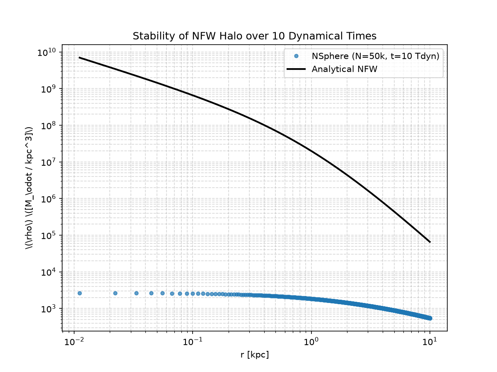
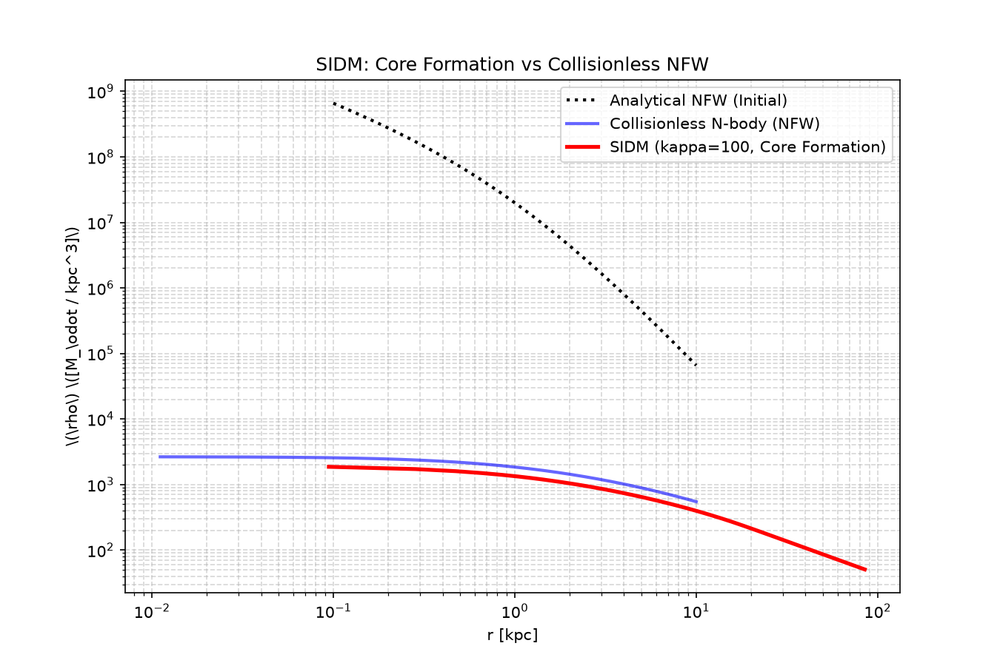

# Spherical DM N-body Pipeline

**A reproducible pipeline for spherical N-body simulations of dark matter halos**, built on top of the [NSphere](https://github.com/kris-sigurdson/NSphere) code. Optimized to run efficiently on standard laptops (no cluster required).

📊 **[Live HTML Report](https://regeditconsulting.github.io/spherical-dm-nbody/report.html)** | 📄 **[PDF Version](report.pdf)**

---

| *Stable NFW halo after 10 dynamical times (N=50,000)* | *SIDM core formation (κ = 100 cm²/g)* |
|---|---|
|  |  |

---

## Key Results

*   **NFW Stability:** The density profile remains consistent with the analytical NFW form over 10 dynamical times, validating the numerical setup and absence of spurious core-crushing.
*   **SIDM Core Formation:** Self-interacting dark matter with cross-section κ = 100 cm²/g produces a flat central core, consistent with gravothermal evolution.

---

## Quick Navigation

*   [Overview](#overview)
*   [Features](#features)
*   [Installation](#installation)
*   [Running a Simulation](#running-a-simulation)
*   [Project Structure](#project-structure)
*   [License](#license)
*   [References](#references)

---

## Overview

This pipeline provides a complete, reproducible workflow for simulating spherically symmetric dark matter halos. It reduces the 6D phase-space to 3D (r, v_r, l), enabling fast N log N evolution. The code supports both collisionless CDM (NFW profile) and self-interacting dark matter (SIDM) with configurable cross-sections. All simulation output is automatically processed into publication-style HTML reports.

---

## Features

-   **NFW Profile:** Initial conditions for Navarro–Frenk–White halos with configurable mass, scale radius, and cutoff.
-   **SIDM:** Core formation and gravothermal collapse via Monte Carlo scattering.
-   **Anisotropy (in progress):** Support for Osipkov–Merritt models.
-   **Fast:** N log N solver reduces 6D phase space to 3D.
-   **Automated Reports:** Generates publication-style HTML reports with annotated plots.

---

## Installation

### Prerequisites
-   macOS (arm64) or Linux
-   Python 3.10+
-   C compiler (clang/gcc), GNU Make, CMake
-   Homebrew (for system dependencies)

### Steps

1.  **Clone the repository:**
    git clone https://github.com/regeditconsulting/spherical-dm-nbody.git
    cd spherical-dm-nbody

2.  **Install system dependencies (macOS example):**
    brew install gsl fftw eigen boost cmake

3.  **Set up Python environment:**
    python3 -m venv env/local/venv
    source env/local/venv/bin/activate
    pip install numpy scipy matplotlib astropy galpy h5py tqdm psutil

4.  **Build NSphere from source:**
    Follow the instructions in refs/NSphere/README.md (the NSphere submodule must be cloned and compiled separately).

---

## Running a Simulation

    # Example: NFW halo with 50,000 particles over 10 dynamical times
    ./refs/NSphere/bin/nsphere \
        --nparticles 50000 --ntimesteps 5000 --tfinal 10 \
        --dtwrite 500 --nout 20 --profile nfw \
        --halo-mass 1.0e9 --scale-radius 1.0 --cutoff-factor 10.0 \
        --tag nfw_long --method 1 --sort 1

    # Generate the HTML report
    python scripts/make_report.py
    open report.html

---

## Project Structure

    ├── README.md              # This file
    ├── LICENSE                # MIT License (this pipeline)
    ├── NOTICE                 # Third-party attributions (NSphere, Apache 2.0)
    ├── .gitignore             # Excludes build artifacts, data, and results
    ├── assets/                # Images for README
    ├── scripts/
    │   ├── gen_ic.py          # Generate initial conditions via galpy
    │   ├── verify_profile.py  # Validate density profile against analytics
    │   ├── overlay_nfw.py     # Plot NFW stability
    │   ├── plot_sidm.py       # Plot SIDM core formation
    │   └── make_report.py     # Generate HTML preprint
    ├── docs/
    │   └── sources.md         # Annotated bibliography
    └── refs/
        └── NSphere/           # N-body engine (cloned locally)

---

## Physics Background

The code solves the collisionless Boltzmann equation for a spherically symmetric system. The phase-space distribution function f(E, L) is sampled to generate initial conditions. The NFW profile is:

    rho(r) = rho_0 / [ (r/r_s) * (1 + r/r_s)^2 ]

For SIDM, elastic scattering is implemented with a user-specified cross-section (cm²/g), enabling the study of core formation and gravothermal collapse.

---

## License

This project is licensed under the MIT License. It uses NSphere, which is licensed under Apache-2.0 (see NOTICE).

---

## References

-   Navarro, J. F., Frenk, C. S., & White, S. D. M. 1996, ApJ, 462, 563
-   Kamionkowski, M., & Sigurdson, K. 2025, arXiv:2504.13996 (NSphere)
-   NSphere repository: https://github.com/kris-sigurdson/NSphere
